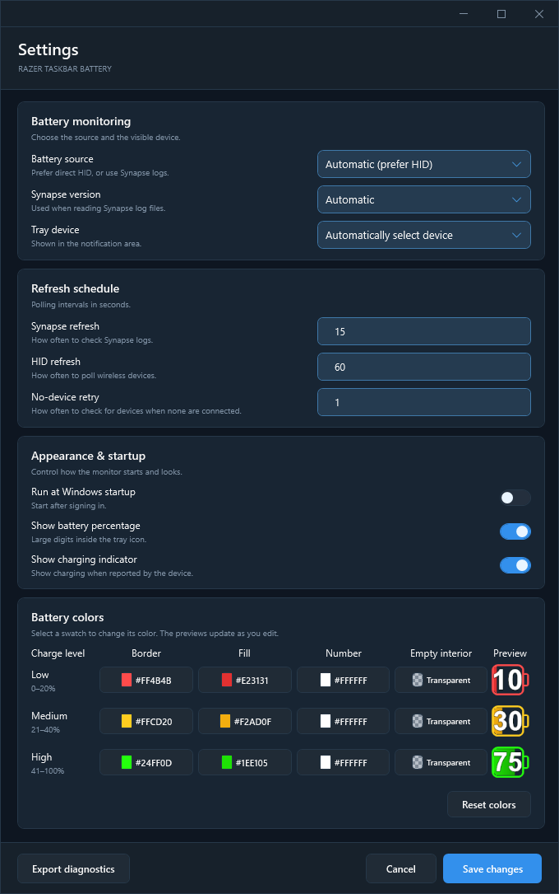
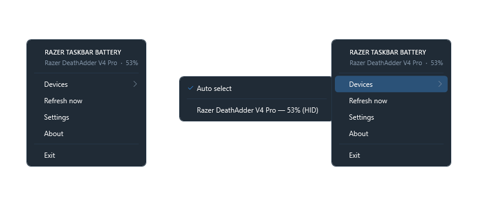

# Razer Taskbar Battery

A lightweight **C# .NET 9 WPF** application that shows Razer-device battery levels in the Windows notification area. It uses Windows HID (`hid.dll` and `setupapi.dll`) and optional Razer Synapse 3/4 log fallback. This project is mainly for a personal usage.

## Screenshots

### Settings

Choose the battery source and tray device, set refresh intervals, and customize the tray icon. **No-device retry** controls how often the app looks for a device when none are connected and defaults to 1 second.

The Release Settings window below is expanded to show all sections, including the color controls and live previews.



### Tray menu

Right-click the tray icon to view battery status, select a device, refresh readings, or open Settings and About. Double-click the tray icon to open Settings directly.



## Battery icon styles

By default, the tray icon uses **green at 41–100%**, **yellow at 21–40%**, and **red at 0–20%**. In **Settings → Battery colors**, change the border, fill, number, and empty interior colors for each range. Live previews show all three ranges as you edit.

Select a swatch to open the color picker, then use the hue slider, color area, Hex or RGB fields, or **Transparent** toggle. Empty interiors default to transparent for all three charge levels. Checkerboard swatches indicate transparency.

**Save changes** applies your colors. **Cancel** discards edits, and **Reset colors** restores the defaults. Previously saved shared interior colors are carried over to all three levels.

Each pair below shows the normal icon followed by its charging variant.

| 10% | 30% | 50% | 70% | 90% | Numeric | Unknown |
| :---: | :---: | :---: | :---: | :---: | :---: | :---: |
|  |  |  |  |  |  |  |

Enable **Show battery percentage** in Settings for the numeric style. An unavailable reading displays a gray icon with a question mark. **Show charging indicator** controls the yellow charging bolt at every supported tray icon size.

Charging status is queried directly over HID using the read-only [OpenRazer power commands](https://github.com/openrazer/openrazer/blob/master/driver/razerchromacommon.c). If the device does not provide a validated charging reply, Automatic mode can use Synapse's charging status instead. A known HID charging state takes precedence over Synapse logs.

## Build and publish

Requires Windows 10/11 (x64) and the .NET 9 SDK or Visual Studio with .NET desktop development workload. On your build machine:

```powershell
dotnet publish .\RazerTaskbarBattery\RazerTaskbarBattery.csproj -c Release -p:PublishProfile=SingleFile --output .\RazerTaskbarBattery\publish
```

The command above creates `RazerTaskbarBattery\publish\RazerTaskbarBattery.exe`. Visual Studio's **SingleFile** profile uses `RazerTaskbarBattery\bin\Release\net9.0-windows\win-x64\publish\` by default. The executable is a self-contained x64 **single-file host** and does not require a separately installed .NET runtime. The OS provides the HID and system-tray APIs.

### Existing data and battery protocol

The migration preserves the previous HID reader, adaptive battery-query detection, OpenRazer device catalog, Synapse 3/4 parsers, settings store and dynamic battery icon drawing. `AppSettings` and the current settings JSON remain compatible. `Version.props` supplies the assembly version displayed in About.

## Diagnostics and limitations

Direct HID isn't universal: different Razer devices can use different report formats and read transaction IDs. Unknown vendor-1532 devices are tested only with known read-only battery-query variants, and responses must pass checksum and status validation. For unsupported devices, Synapse log fallback may work.

Diagnostics may contain Windows HID paths with identifying device details; review before sharing.
